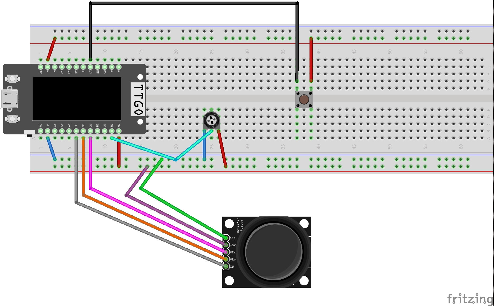
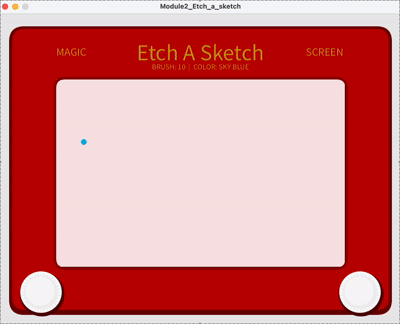

# Digital Etch A Sketch

## Project Overview

Digital Etch A Sketch is an interactive drawing project inspired by the original Etch A Sketch toy. I built it with an ESP32, joystick, push button, and potentiometer, using Processing on my computer to display the drawing interface.

Instead of turning physical knobs like the original toy, users move a joystick to draw on the screen. They can also change the brush size, switch colors, and clear their drawing using the other controls.

## My Design Goals

I wanted to make digital drawing feel more hands-on and playful by using physical controls instead of a mouse. I kept the red frame of the original Etch A Sketch but gave the interface a different look with a pink-toned drawing area and different settings for the brush size and color.

My main goal was to create a simple and easy drawing experience where users can feel the nostalgia of the original toy while also experimenting with different colors and brush sizes. 

## How It Works

- **Joystick:** Moves the drawing cursor around the screen.
- **Joystick click:** Changes between three brush sizes: 4, 7, and 10.
- **Red push button:** Clears the drawing screen.
- **Potentiometer:** Switches between five colors.
- **ESP32:** Reads the physical controls and sends their values to Processing through serial communication.
- **Processing:** Displays the interface and draws the lines based on the physical inputs.

## Hardware

Components used:

- ESP32 TTGO T-Display
- Joystick 
- Push button
- Potentiometer
- Breadboard
- Jumper wires
- USB cable
- Computer running Arduino IDE and Processing

## Circuit Connections

The joystick's VRX pin connects to GPIO 39, VRY connects to GPIO 32, and SW connects to GPIO 33. The red push button connects to GPIO 2, and the middle pin of the potentiometer connects to GPIO 36. The joystick and potentiometer also connect to the ESP32's 3.3V and GND pins. The potentiometer's two outer pins connect to power and ground.

## Software

- Arduino IDE
- Processing

First, connect the joystick, push button, and potentiometer to the ESP32 using the circuit diagram above. Open the Arduino sketch in Arduino IDE, select your ESP32 board and the correct serial port, and upload the code. Next, open the Processing sketch and update the serial port setting so it matches the port connected to your ESP32. Make sure the baud rate matches the Arduino code, then run the Processing sketch. Once connected, you can use the physical controls to start drawing.

## Demonstration

Here is a short demonstration of what the project should look like once the hardware and software are all connected:

## AI Support Used

I used ChatGPT (GPT-6) for coding assistance and troubleshooting during this project. It helped me understand parts of my Arduino and Processing code, work through hardware and serial connection issues, and make improvements to the drawing interface.

Two examples of prompts I used were: "Why does my Mac show the cu.usbserial port as disconnected, even though my ESP32 was connecting and working before?" and "How can I add an indicator on the screen that displays the currently selected brush size and color so users know what they're using without changing the original Etch A Sketch-inspired design?"

I used the suggestions to help troubleshoot and make changes, then tested the code and hardware to see what worked for my project.

